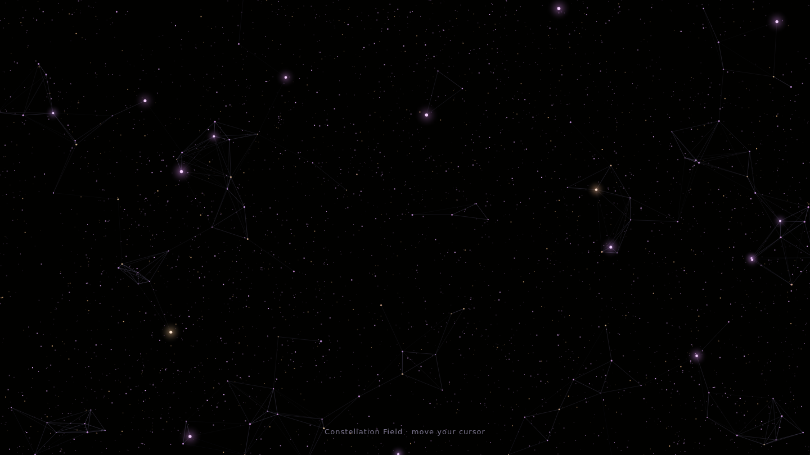

# Vibe-UI

Leo 自己做的可复用前端 UI 组件合集，每个组件一个目录，零依赖、可直接拷走使用。

| 组件 | 说明 | 用在 |
| --- | --- | --- |
| [constellation-field](./constellation-field) | 星空连线 Canvas 背景 | [li.trageek.com](https://li.trageek.com/) |

---

## constellation-field · 星空连线背景



Canvas 2D 实时绘制，无任何第三方依赖：

- 沿流场缓慢漂移的星尘（紫色为主，少量暖色）
- 稀疏的星点按距离自动连线，部分"锚点"带呼吸光晕
- 鼠标轻微视差，星尘层比连线层移动更多，有纵深感
- 按屏幕面积自动调整粒子数量，DPR 上限为 2
- 遵循 `prefers-reduced-motion`；切到后台标签页自动暂停

本地预览：

```sh
cd constellation-field
python3 -m http.server 8080
# 打开 http://localhost:8080
```

### 原生 JS

```html
<canvas id="field" style="position:fixed;inset:0;width:100%;height:100%"></canvas>
<script type="module">
  import { createConstellationField } from "./constellation-field.js";
  const destroy = createConstellationField(document.getElementById("field"));
  // 不需要时调用 destroy() 释放
</script>
```

画布尺寸由 CSS 决定，脚本用 ResizeObserver 跟随，无需手动处理 resize。

### Vue 3

把 `ConstellationField.vue` 放进项目，在需要背景的容器里使用（组件是 `position: absolute; inset: 0`，父元素需 `position: relative`）：

```vue
<script setup lang="ts">
import ConstellationField from "./ConstellationField.vue";
</script>

<template>
  <div style="position: relative; height: 100vh">
    <ConstellationField />
    <!-- 页面内容 -->
  </div>
</template>
```

Vue 版使用 `<style lang="scss">`，项目里需要安装 `sass`；不用 SCSS 的话把它改成普通 `<style>` 即可。

### 调参

两个文件顶部的 `tuning` 常量即可调整效果：

| 常量 | 作用 |
| --- | --- |
| `SEED` | 随机种子，固定后每次布局一致 |
| `DUST_AT_REF` / `NODES_AT_REF` | 1440×810 下的星尘 / 星点数量 |
| `LINK_DIST` | 连线的最大距离（px） |
| `PARALLAX_MAX` | 鼠标视差最大偏移 |
| `HUES` / `WARM_SHARE` | 主色与暖色色相、暖色比例 |
| `ANCHOR_SHARE` | 带光晕锚点的比例 |
| `BG` | 背景色 |

## License

MIT
